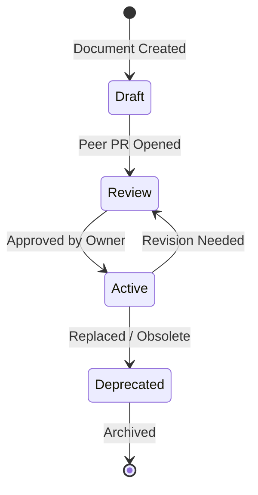

# Documentation Standards & Governance

> **Engineering Excellence — SOTA Documentation Grade**
> 
> *The authoritative guidelines for documentation creation, maintenance, lifecycle, and formatting inside PranaKaia.*

---

## 🎯 Vision

At PranaKaia, documentation is not an afterthought; it is treated with the same architectural rigor, code review, and versioning standards as our production TypeScript codebase. High-quality documentation reduces engineer cognitive load, prevents outages, and ensures a seamless developer onboarding experience. We strictly enforce the **"Documentation-as-Code"** paradigm.

---

## 🏗️ Structural Hierarchy

To maintain discoverability, every document must be stored in its appropriate sub-folder matching its domain classification:

| Directory | Purpose | Naming Convention | Examples |
| :--- | :--- | :--- | :--- |
| **`adr/`** | Architecture Decision Records | `0NNN-kebab-case.md` | `0004-upstash-caching.md` |
| **`context/`** | Living system designs and schemas | `kebab-case.md` | `database.md`, `domain.md` |
| **`runbooks/`** | Step-by-step incident response/maintenance | `action-subject.md` | `recovery-rollback.md` |
| **`guides/`** | Onboarding tutorials and setup guides | `type-subject.md` | `setup-local-dev.md` |
| **`policies/`** | Legal, engineering, and security policies | `subject-policy.md` | `security-policy.md` |
| **`specs/`** | Deep technical specs, RFCs, and API scopes | `domain-subject.md` | `identity-auth-v2.md` |
| **`audits/`** | Verification lists and security audits | `audit-type-date.md` | `audit-secrets-2026.md` |

---

## 📑 Document Quality Standards (S+ Grade)

Every primary markdown document in this repository MUST fulfill these visual and content requirements:

### 1. YAML Frontmatter Block
Every file must start with a valid YAML block enclosed by `---` lines:
```yaml
---
title: Official Document Title
version: 1.2.0
status: [Draft | Review | Active | Deprecated]
last_updated: YYYY-MM-DD
owner: [Role or Bounded Context Name]
tags: [comma, separated, tag, list]
---
```

### 2. Header and Executive Summary
Directly under the YAML block, use a single `#` level heading for the title, followed by a professional blockquote summarizing the "Why" and "What" of the document.

### 3. Clear Typographical Hierarchy
- Use `#` only once for the main title.
- Use `##` for primary sections.
- Use `###` for sub-sections.
- Do not skip levels (e.g., going from `#` to `####`).

### 4. Rich Visual Elements
- **Mermaid Diagrams:** Use standard Mermaid diagrams to explain state transitions, system networking, sequence flows, or folder dependency boundaries.
- **GitHub Alerts:** Strategically place `[!NOTE]`, `[!TIP]`, `[!IMPORTANT]`, `[!WARNING]`, and `[!CAUTION]` to emphasize critical details.

---

## ✍️ Writing Style & Voice

- **Professional Tone:** Technical English (US spelling), direct, action-oriented, and objective.
- **Strict Clarity:** Avoid vague words like "maybe", "probably", "sometimes". Instead write "retry 3 times with exponential backoff," "guarantees 99.9% uptime," etc.
- **Active Voice:** Write "Configure the environment variables" instead of "The environment variables should be configured by the developer."

---

## 🔄 Lifecycle Management

Documentation tracks the state of our product. Every document must transitions through these lifecycle stages:



- **Draft:** Work-in-progress. Not yet ready for production engineering guidance.
- **Review:** Open for team reviews or technical steering feedback.
- **Active:** The absolute current source of truth. Fully trusted and verified.
- **Deprecated:** Retained for historical context but no longer to be used in production.

---
> **Document Control**
> - **Primary Owner:** Technical Architecture Council
> - **Revision Interval:** Annual
