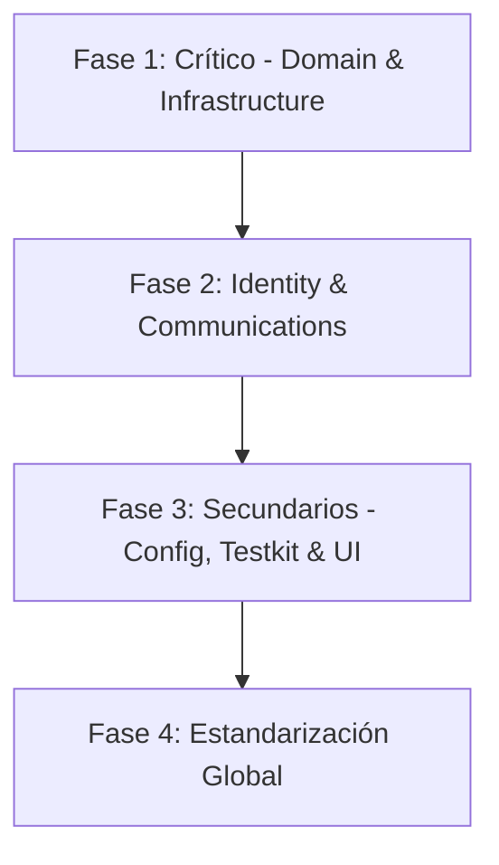

# Package Elevation Master Plan

> **Enterprise-Grade Packaging & Mono-Repo Optimization Strategy**
> 
> *The strategic roadmap for elevating shared packages to 100% type safety, deterministic builds, and perfect boundary isolations.*

---

## 📋 Executive Summary

This master plan details the systematic engineering refactoring of all `packages/` workspaces in the PranaKaia monorepo. The goal is to bring every library to the highest industry packaging standards.

### 🏆 Platinum Acceptance Criteria
Every single package inside the monorepo must strictly satisfy:
- **Zero Type Errors:** Run completely clean under strict compiler flags (`tsc --noEmit`).
- **100% Test Passing Rate:** Robust local Vitest suite coverage with zero failing tests.
- **Biome Lint Compliance:** Clean automated formatting and lint verification (`pnpm biome lint`).
- **Triple Build Outputs:** ESM + CommonJS formats along with bundle-ready declaration files (`dts`).
- **ATTW (Are The Types Wrong) Validation:** No resolution problems, dual-package hazard issues, or missing type references.
- **Publint Verification:** Absolute npm standards compliance for all `package.json` configurations.

---

## 🎯 Current Status

We classify packages based on their architectural importance and stability.

### 🟢 Completed & Verified Packages (11/18)

| Bounded Context / Shared Library | Test Status | Type Check | Build Output | ATTW | Publint | Status |
| :--- | :--- | :--- | :--- | :--- | :--- | :--- |
| **`cart`** | ✅ Passing | ✅ Clean | ✅ ESM + CJS | ⚠️ Dual | ✅ Clean | Stable |
| **`catalog`** | ✅ Passing | ✅ Clean | ✅ ESM + CJS | ⚠️ Dual | ✅ Clean | Stable |
| **`checkout`** | ✅ Passing | ✅ Clean | ✅ ESM + CJS | ⚠️ Dual | ✅ Clean | Stable |
| **`inventory`** | ✅ Passing | ✅ Clean | ✅ ESM + CJS | ⚠️ Dual | ✅ Clean | Stable |
| **`payments`** | ✅ Passing | ✅ Clean | ✅ ESM + CJS | ✅ Clean | ✅ Clean | Stable |
| **`application`** | ✅ Passing | ✅ Clean | ✅ ESM + CJS | N/A | ✅ Clean | Stable |
| **`pricing`** | ✅ Passing | ✅ Clean | ✅ ESM + CJS | ⚠️ Dual | ✅ Clean | Stable |
| **`supplier`** | ✅ Passing | ✅ Clean | ✅ ESM + CJS | ⚠️ Dual | ✅ Clean | Stable |
| **`logistics`** | ✅ Passing | ✅ Clean | ✅ ESM + CJS | ⚠️ Dual | ✅ Clean | Stable |
| **`shipping`** | ✅ Passing | ✅ Clean | ✅ ESM + CJS | ✅ Clean | ✅ Clean | Stable |
| **`shared-kernel`** | ✅ Passing | ✅ Clean | ✅ ESM + CJS | ✅ Clean | ✅ Clean | Stable |

### 🔧 Packages in Active Migration (7/18)

| Package | Test Status | Type Check | Build Output | ATTW | Publint | Priority |
| :--- | :--- | :--- | :--- | :--- | :--- | :--- |
| **`domain`** | 🆕 Brand New | ❌ Pending | ❌ Pending | ❌ Pending | ❌ Pending | 🔴 CRITICAL |
| **`infrastructure`** | ✅ Stub | ❌ Pending | ❌ Pending | ❌ Pending | ❌ Pending | 🔴 CRITICAL |
| **`identity`** | ✅ Passing | ❌ TS Errors | ❌ Pending | ❌ Pending | ❌ Pending | 🟡 HIGH |
| **`communications`** | ✅ Passing | ❌ Pending | ❌ Pending | ❌ Pending | ❌ Pending | 🟡 HIGH |
| **`config`** | ✅ Passing | N/A (Config) | N/A (Config) | N/A | N/A | 🟢 MEDIUM |
| **`testkit`** | ✅ Passing | ❌ Pending | ❌ Pending | ❌ Pending | ❌ Pending | 🟢 LOW |
| **`ui`** | ✅ Passing | ❌ Pending | ❌ Pending | ❌ Pending | ❌ Pending | 🟢 LOW |

---

## 🚀 Phase-by-Phase Execution Plan



### Phase 1: Core Domain & Infrastructure
1. Initialize monorepo dependency mappings via `pnpm install`.
2. Run automated validation checks specifically targeting `@pranakaia/domain` and `@pranakaia/infrastructure`.
3. Resolve compilation errors associated with database schema configurations or drizzle models inside packages.

### Phase 2: Security & Communications
1. Fix TS path resolutions inside `@pranakaia/identity`. Ensure exact types are cleanly exported using `export type` instead of raw declarations.
2. Resolve build hazards and missing file configurations in `@pranakaia/communications`.

---

## 🛠️ Monorepo Validation Commands

Use these exact commands during local development or CI/CD pipelines to ensure compliance with our platinum criteria:

### Single Package Quality Check
```bash
pnpm --filter @pranakaia/<package-name> test && \
pnpm --filter @pranakaia/<package-name> type-check && \
pnpm --filter @pranakaia/<package-name> build && \
pnpm --filter @pranakaia/<package-name> attw && \
pnpm --filter @pranakaia/<package-name> publint
```

### Monorepo Validation Script
```bash
# Execute full validation suite across the monorepo
pnpm exec pwsh scripts/validate-packages.ps1
```

---
> **Document Control**
> - **Revision:** 1.1.0
> - **Review Schedule:** Bi-weekly
