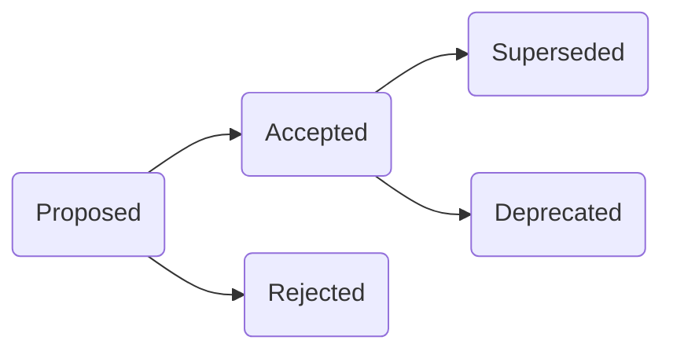

# Architecture Decision Records (ADR)

> **Strategic Technical Decisions Log**
>
> *Version: 4.0-AbsoluteZero | Status: ACTIVE | Last Updated: 2026-04-28*
> *Classification: INTERNAL*

---

## 📖 Overview

Architecture Decision Records (ADRs) capture significant technical decisions, the context in which they were made, the alternatives considered, and the final rationale. This log serves as the historical record of the system's evolution.

## 📝 ADR Lifecycle

---

## 🗂️ Decision Log

| ID | Title | Status | Date |
| :--- | :--- | :--- | :--- |
| [**0001**](./0001-modular-monolith-architecture.md) | Modular Monolith Architecture | ACCEPTED | 2026-04-26 |
| [**0002**](./0002-drizzle-orm-adoption.md) | Drizzle ORM for Type-Safe Database Access | ACCEPTED | 2026-04-26 |
| [**0003**](./0003-observability-and-roadmap-governance.md) | Observability & Roadmap Governance | ACCEPTED | 2026-04-26 |
| [**0004**](./0004-nextjs-15-standardization.md) | Next.js 15 Standardization | ACCEPTED | 2026-04-27 |
| [**0005**](./0005-auth-unification-supabase.md) | Auth Unification with Supabase | ACCEPTED | 2026-04-27 |
| [**0006**](./0006-type-safety-hardening.md) | System-wide Type Safety Hardening | ACCEPTED | 2026-04-27 |
| [**0007**](./0007-todo-triage-process.md) | TODO Triage and Debt Management Process | ACCEPTED | 2026-04-27 |
| [**0008**](./0008-dependency-audit-security.md) | Dependency Audit & Security Hardening | ACCEPTED | 2026-04-27 |
| [**0009**](./0009-database-schema-expansion.md) | Database Schema Expansion (Product Variants) | ACCEPTED | 2026-04-27 |
| [**0010**](./0010-api-design-restful.md) | RESTful API Design Principles | ACCEPTED | 2026-04-27 |

---

## 🛠️ ADR Template

Always use the [**template.md**](./template.md) for new records to ensure consistency in capturing context, consequences, and alternatives.

---

> **Document Control**
> - **Owner:** Architecture Review Board (ARB)
> - **Governance:** Every ADR requires at least 2 Peer Approvals.
