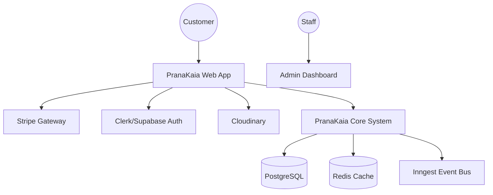
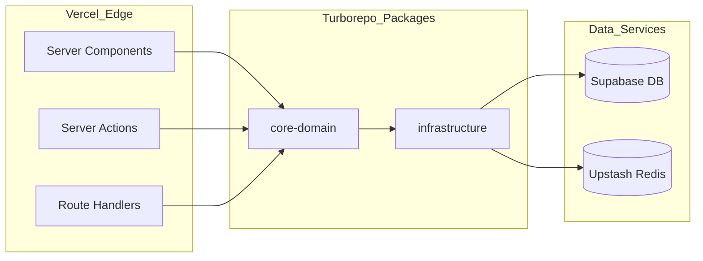
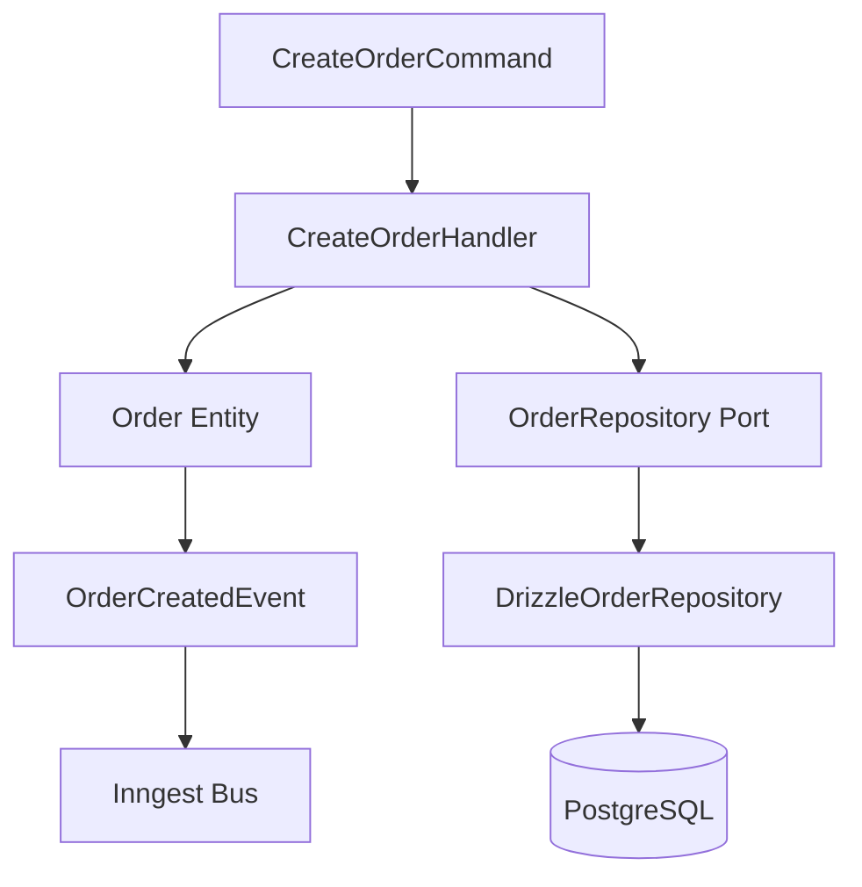

# System Models: C4 Visualization
 
> **🏆 ABSOLUTE ZERO - Architectural Transparency**
>
> *Version: 5.0 | Status: 🔒 Stable | Notation: C4 Model*
 
---
 
## 📋 Context Diagram (Level 1)
 
Visualizes how the PranaKaia system interacts with external actors and services.
 

 
---
 
## 🏗️ Container Diagram (Level 2)
 
Breakdown of the system into high-level technical containers.
 

 
---
 
## 🧩 Component Diagram (Level 3)
 
Detailed view of a single bounded context (e.g., Orders).
 

 
---
 
## 🚦 Modeling Governance
 
1. **Consistency**: Any change to `ARCHITECTURE-STANDARD.md` must be reflected in these diagrams.
2. **Clarity**: Use standard C4 notation (Context, Containers, Components, Code).
3. **Living Docs**: Diagrams are embedded as Mermaid code to ensure they stay up-to-date with the codebase.
 
---
 
## 📝 Document Control
 
| Role | Responsibility |
| :--- | :--- |
| **Owner** | Architecture Guild |
| **Last Audit** | 2026-04-28 |
| **Next Review** | 2026-10-28 |
