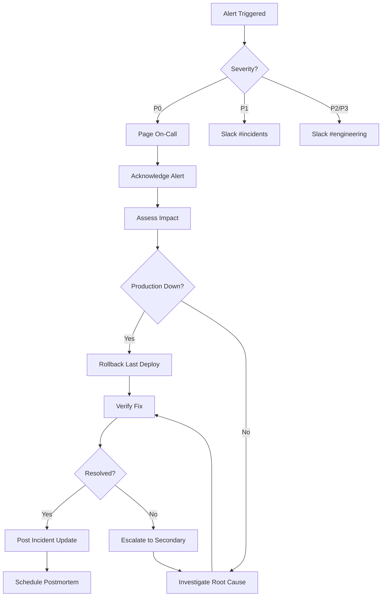

# Monitoring & Alerting

## Overview

This document defines monitoring alerts, escalation procedures, and incident response protocols for the E-Commerce platform.

## Alert Definitions

### Critical Alerts (P0 - Page Immediately)

#### 1. High Error Rate

- **Metric**: Error rate > 1% over 5 minutes
- **Impact**: Customer transactions failing
- **Alert Channels**: PagerDuty + Slack #incidents
- **Response Time**: < 5 minutes
- **Action**:
  1. Check Sentry dashboard for error trends
  2. Review recent deployments (last 2 hours)
  3. Check infrastructure status (Vercel, Supabase, Upstash)
  4. Rollback if regression identified
  5. Post incident update in #incidents

#### 2. High API Latency

- **Metric**: p95 latency > 500ms over 10 minutes
- **Impact**: Slow user experience, potential timeout failures
- **Alert Channels**: PagerDuty + Slack #incidents
- **Response Time**: < 10 minutes
- **Action**:
  1. Check Vercel Analytics performance tab
  2. Review database query performance in Prisma logs
  3. Check Redis cache hit rates
  4. Investigate slow queries with `EXPLAIN ANALYZE`
  5. Scale infrastructure if needed

#### 3. Database Connection Errors

- **Metric**: Database connection pool exhausted or connection errors > 10/min
- **Impact**: All transactions blocked
- **Alert Channels**: PagerDuty + Slack #incidents
- **Response Time**: < 5 minutes
- **Action**:
  1. Check Supabase dashboard for connection pool status
  2. Review active connections: `SELECT * FROM pg_stat_activity`
  3. Kill long-running queries if blocking
  4. Increase connection pool size if needed
  5. Check for connection leaks in application logs

### High Priority Alerts (P1 - Page During Business Hours)

#### 4. Elevated 5xx Errors

- **Metric**: 5xx errors > 0.5% over 15 minutes
- **Impact**: Intermittent failures affecting some transactions
- **Alert Channels**: Slack #engineering
- **Response Time**: < 30 minutes
- **Action**:
  1. Review Sentry error grouping
  2. Check affected routes in observability logs
  3. Investigate root cause
  4. Create hotfix if critical path affected

#### 5. Cache Unavailability

- **Metric**: Redis connection failures > 5 in 5 minutes
- **Impact**: Degraded performance, increased database load
- **Alert Channels**: Slack #engineering
- **Response Time**: < 30 minutes
- **Action**:
  1. Check Upstash Redis dashboard
  2. Review cache fallback behavior in logs
  3. Monitor database load increase
  4. Contact Upstash support if prolonged outage

#### 6. Payment Processing Delays

- **Metric**: Webhook processing time > 10 seconds avg
- **Impact**: Delayed order confirmations
- **Alert Channels**: Slack #engineering
- **Response Time**: < 1 hour
- **Action**:
  1. Check Stripe webhook history for retries
  2. Review observability logs for webhook handler
  3. Check email service status (Resend)
  4. Verify database write performance

### Medium Priority Alerts (P2 - Monitor & Act Within 4 Hours)

#### 7. Low Cache Hit Rate

- **Metric**: Cache hit rate < 70% over 1 hour
- **Impact**: Increased database load, higher costs
- **Alert Channels**: Slack #engineering (no page)
- **Response Time**: < 4 hours
- **Action**:
  1. Review cache keys and TTLs in `cache-tags.ts`
  2. Analyze most-fetched uncached queries
  3. Optimize cache strategy
  4. Consider preloading popular products

#### 8. Elevated Memory Usage

- **Metric**: Memory usage > 80% for 30 minutes
- **Impact**: Potential OOM crashes
- **Alert Channels**: Slack #engineering
- **Response Time**: < 4 hours
- **Action**:
  1. Check Vercel function logs for memory metrics
  2. Review recent code changes for memory leaks
  3. Analyze heap snapshots if available
  4. Scale function memory if needed

#### 9. Low Test Coverage Drop

- **Metric**: Coverage drops below threshold (< 40% MVP, < 60% Prod)
- **Alert Channels**: GitHub PR comment + Slack #engineering
- **Response Time**: Before merge
- **Action**:
  1. Block PR merge
  2. Run `pnpm test:coverage:analyze` locally
  3. Add tests for uncovered critical paths
  4. Review coverage report: `coverage/lcov-report/index.html`

### Info Alerts (P3 - No Page, Log Only)

#### 10. New Sentry Issue

- **Metric**: New error type detected
- **Impact**: Potential bug affecting subset of users
- **Alert Channels**: Sentry digest email (daily)
- **Response Time**: Next sprint planning
- **Action**:
  1. Review error details and frequency
  2. Add to backlog if affecting > 1% of requests
  3. Monitor for trend increases

#### 11. Deployment Success/Failure

- **Metric**: Vercel deployment status
- **Impact**: Informational
- **Alert Channels**: Slack #deployments
- **Response Time**: N/A
- **Action**:
  1. Success: Monitor Sentry for new errors in first 10 minutes
  2. Failure: Review build logs, fix and redeploy

## Sentry Configuration

### Alert Rules (Configure After Adding DSN)

1. **Error Spike Detection**
   - Condition: Errors increase by 200% vs previous hour
   - Frequency: Every 10 minutes
   - Action: Send to Slack #incidents

2. **New Issues**
   - Condition: New unique error fingerprint
   - Frequency: Real-time
   - Action: Send to Slack #engineering

3. **Performance Degradation**
   - Condition: Transaction duration p95 > 1s
   - Frequency: Every 15 minutes
   - Action: Send to Slack #engineering

4. **High Frequency Errors**
   - Condition: Same error occurs > 100 times in 1 hour
   - Frequency: Hourly
   - Action: Send to PagerDuty + Slack #incidents

### Sentry Issue Filters

Already configured in `sentry.server.config.ts`:

- ✅ Rate limit errors (429) - Ignored
- ✅ Not found errors (404) - Ignored
- ✅ Hydration mismatches - Ignored
- ✅ PII filtering active (cookies, auth headers removed)
- ✅ Sampling: 10% in production, 100% in dev/preview

### Adding Sentry DSN

**Production:**

```bash
# Add to Vercel environment variables
vercel env add SENTRY_DSN production
# Value: https://<key>@<org>.ingest.sentry.io/<project>
```

**Preview:**

```bash
vercel env add SENTRY_DSN preview
```

**Local Development:**

```bash
# Add to .env.local
SENTRY_DSN="https://<key>@<org>.ingest.sentry.io/<project>"
```

**Test Error Capture:**

```bash
# Trigger test error
curl https://your-domain.com/api/sentry-test

# Verify in Sentry dashboard within 30 seconds
```

## Vercel Monitoring

### Enabled Monitors (No Configuration Needed)

1. **Analytics** (`@vercel/analytics`)
   - Page views, unique visitors
   - Top pages, referrers
   - Dashboard: https://vercel.com/[team]/[project]/analytics

2. **Speed Insights** (`@vercel/speed-insights`)
   - Real User Monitoring (RUM)
   - Core Web Vitals: LCP, FID, CLS
   - Performance score by page

### Vercel Alerts (Configure in Dashboard)

**Settings → Alerts:**

- ✅ Deployment Failed
- ✅ Deployment Succeeded (optional, can be noisy)
- ✅ Domain Configuration Issues
- ✅ Build Time Exceeded (threshold: 5 minutes)

**Integration Recommendations:**

- Configure Slack webhook in Vercel for deployment notifications
- Send alerts to `#deployments` channel

## Observability Logs

### Querying Logs Locally

**Search for errors:**

```bash
pnpm turbo run dev --filter=web | grep -i "error"
```

**Filter by API route:**

```bash
pnpm turbo run dev --filter=web | grep "path: '/api/products'"
```

### Production Logs (Vercel)

**Real-time streaming:**

```bash
vercel logs --follow --project=e-commerce-web
```

**Filter by function:**

```bash
vercel logs --filter=/api/orders
```

**Export logs (last 24h):**

```bash
vercel logs --since=24h --output=logs.txt
```

## Infrastructure Status Pages

### External Dependencies

1. **Vercel Status**: https://www.vercel-status.com/
2. **Supabase Status**: https://status.supabase.com/
3. **Upstash Status**: https://upstash.com/status
4. **Stripe Status**: https://status.stripe.com/
5. **Resend Status**: https://status.resend.com/

**Check during incidents**: Always verify third-party status before debugging internal issues.

## Escalation Procedures

### Incident Severity

| Severity          | Response Time | Examples                                         |
| ----------------- | ------------- | ------------------------------------------------ |
| **P0 - Critical** | < 5 min       | Site down, payment failures, data breach         |
| **P1 - High**     | < 30 min      | High error rates, slow checkout, database issues |
| **P2 - Medium**   | < 4 hours     | Cache issues, memory leaks, elevated latency     |
| **P3 - Low**      | Next sprint   | Feature bugs, minor UI issues, documentation     |

### On-Call Rotation

**Primary On-Call**:

- Receives all P0 alerts via PagerDuty
- Responds within 5 minutes
- Initiates incident response
- Updates #incidents channel

**Secondary On-Call**:

- Escalation if primary doesn't respond in 10 minutes
- Provides support during major incidents
- Reviews incidents next day

### Incident Response Flow



### Post-Incident Review

**Within 48 hours of P0/P1 incidents:**

1. **Incident Timeline** (in Google Docs)
   - What happened?
   - When was it detected?
   - How long to resolve?
   - Customer impact estimate

2. **Root Cause Analysis**
   - Why did it happen?
   - What was missed in testing?
   - Related alerts that were ignored?

3. **Action Items**
   - Prevent recurrence (code fixes)
   - Improve detection (better alerts)
   - Improve response (runbook updates)

4. **Share Learnings**
   - Post summary in #engineering
   - Update runbooks in `ops/runbooks/`
   - Add regression tests

## Dashboard Links

### Production Dashboards

**Vercel:**

- Deployments: https://vercel.com/[team]/web-ecommerce/deployments
- Analytics: https://vercel.com/[team]/web-ecommerce/analytics
- Logs: https://vercel.com/[team]/web-ecommerce/logs

**Sentry:** (Configure after adding DSN)

- Issues: https://sentry.io/organizations/[org]/issues/
- Performance: https://sentry.io/organizations/[org]/performance/
- Releases: https://sentry.io/organizations/[org]/releases/

**Supabase:**

- Database: https://app.supabase.com/project/[project]/database/tables
- Logs: https://app.supabase.com/project/[project]/logs/explorer

**Upstash Redis:**

- Dashboard: https://console.upstash.com/redis/[db-id]
- Metrics: https://console.upstash.com/redis/[db-id]/metrics

### Monitoring Commands

**Check test coverage:**

```bash
pnpm test:coverage:analyze
```

**Run all tests:**

```bash
pnpm test
```

**Lint codebase:**

```bash
pnpm lint
```

**Check Prisma migrations:**

```bash
cd packages/db && pnpm prisma migrate status
```

## Alert Fatigue Prevention

### Best Practices

1. **Tune Thresholds**: Review alert frequency monthly, adjust noisy alerts
2. **Group Related Alerts**: Use Sentry issue grouping, don't alert on same root cause twice
3. **Weekend Silence**: P2/P3 alerts only during business hours (Mon-Fri 9am-6pm)
4. **Progressive Escalation**: Start with Slack, only page for true emergencies
5. **False Positive Tracking**: Document and fix alerts that fire incorrectly

### Alert Review Schedule

**Weekly** (Mondays):

- Review P2/P3 alerts from previous week
- Identify patterns
- Propose alert tuning changes

**Monthly** (First Friday):

- Review all alert thresholds
- Update this document with new alerts
- Archive resolved recurring issues

## Next Steps

1. ✅ Sentry DSN configured → Enable alert rules
2. ✅ Test all alert channels (send test notifications)
3. ✅ Create PagerDuty schedules for on-call rotation
4. ✅ Set up Slack webhooks for Vercel + Sentry
5. ✅ Document runbooks in `ops/runbooks/` for common incidents
6. ✅ Schedule first incident response drill

---

**Last Updated**: Sprint 2
**Owner**: DevOps Team
**Review Frequency**: Monthly
